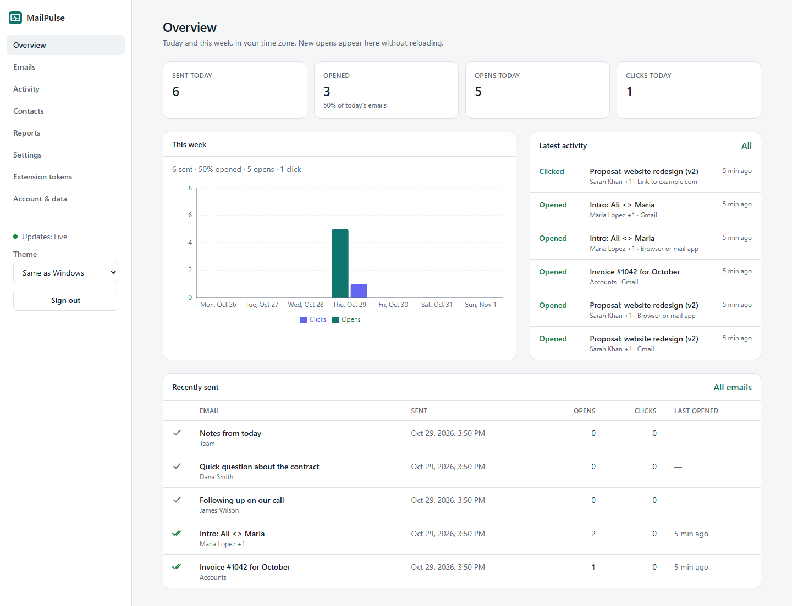
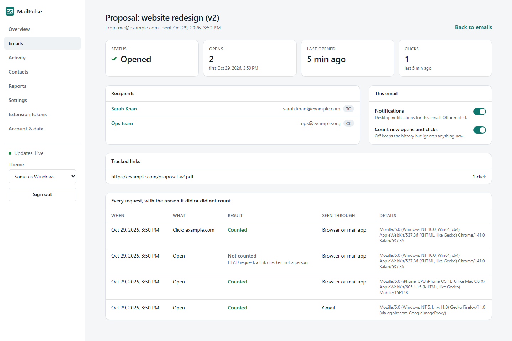
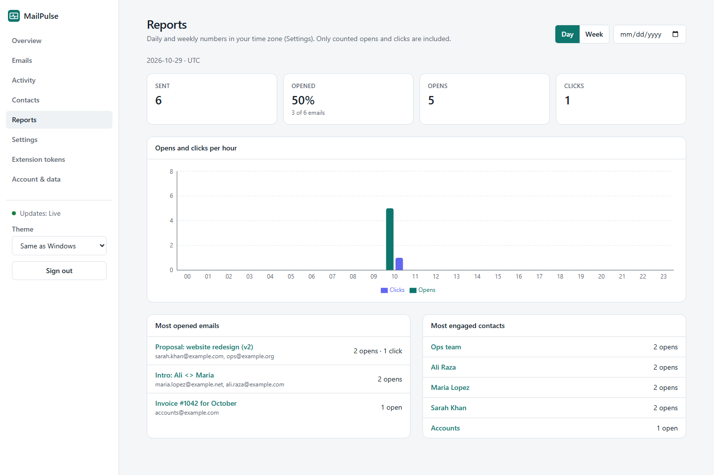
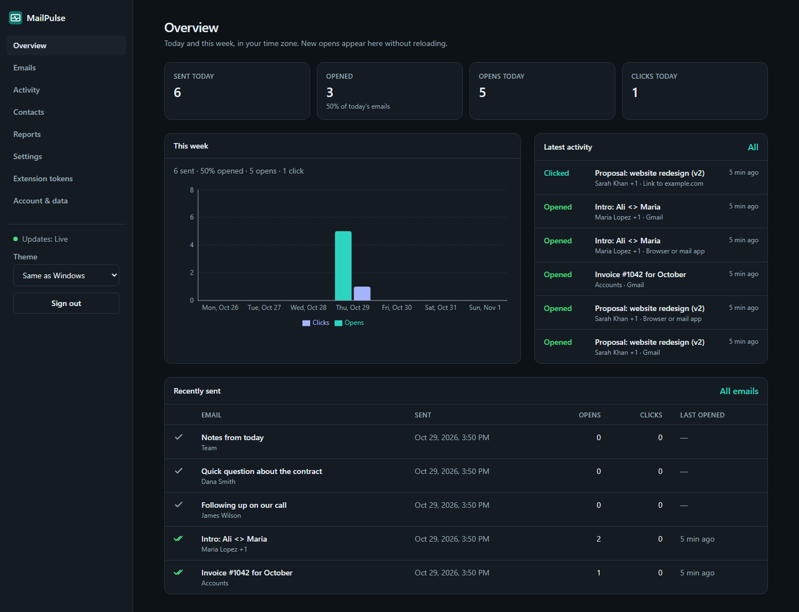
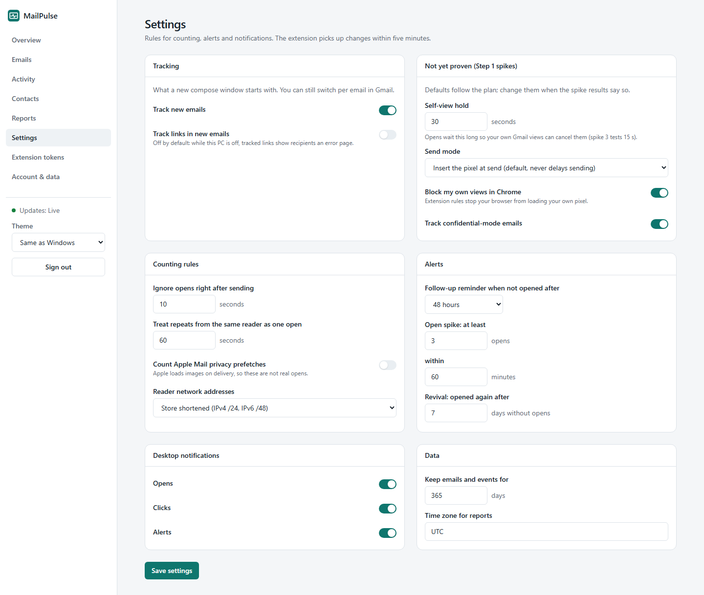
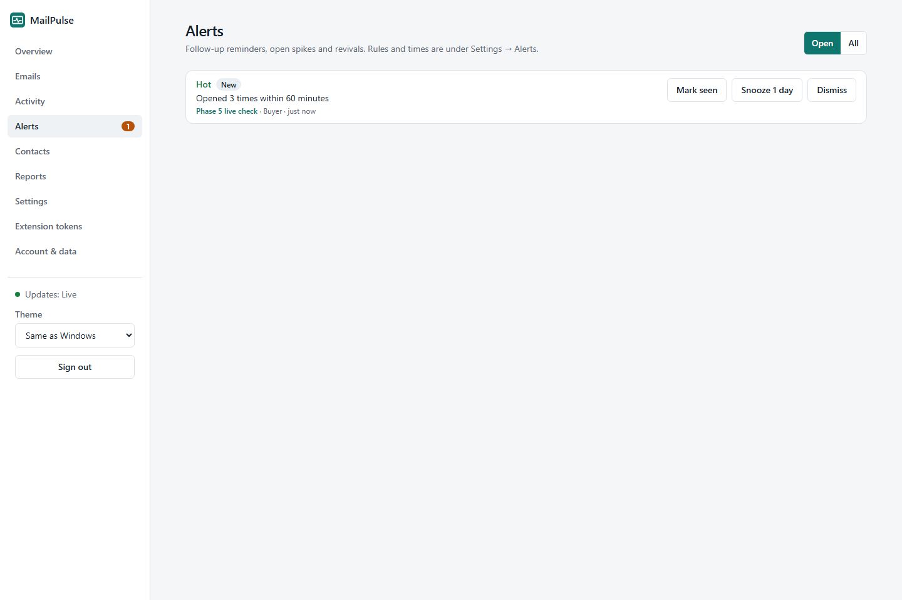
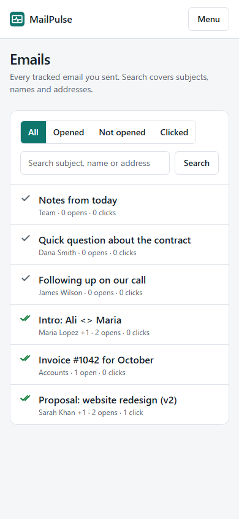

# MailPulse

A private, self-hosted open and click tracker for one person's Gmail. A Chrome extension adds an
invisible pixel to emails you send; when the recipient's mail app loads it, MailPulse records the
open and shows ✓/✓✓ marks in Gmail, desktop notifications and a dashboard. Everything runs on your
own PC with free tools; no email body ever leaves your browser.

Status: backend (Phase 1), public access through Tailscale Funnel (Phase 2), the Chrome extension
(Phase 3), the dashboard (Phase 4) and link tracking with alerts (Phase 5) are built. Install steps: [docs/SETUP.md](docs/SETUP.md).

## Screenshots
Dashboard with test data (example.com addresses), light and dark:



| | |
|---|---|
|  |  |
|  |  |
|  |  |

## Quick start (Windows 11, PowerShell)
Requires Java 25, Docker Desktop and Tailscale (see [docs/SETUP.md](docs/SETUP.md)).

```powershell
.\scripts\new-env.ps1     # creates infra\.env with secrets - back up the encryption key!
.\scripts\dev.ps1         # builds the dashboard, starts PostgreSQL + backend: dashboard/API 127.0.0.1:8080, tracking 8081
.\scripts\funnel.ps1      # publishes only /t/ and /c/ on your Tailscale address and checks them
.\scripts\autostart.ps1 -Install   # start everything at Windows sign-in
.\scripts\verify.ps1      # all checks: build, unit and integration tests, dependency audit
```

## Documentation
- [docs/PLAN.md](docs/PLAN.md) — architecture, data model, API, security, phases
- [docs/DECISIONS.md](docs/DECISIONS.md) — every decision and why
- [docs/SETUP.md](docs/SETUP.md) — setup, backup and restore
- [docs/LIMITATIONS.md](docs/LIMITATIONS.md) — what tracking can and cannot see
- [docs/FEATURES.md](docs/FEATURES.md) — feature scope compared with Mailsuite
